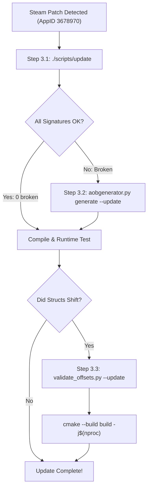

# TaskBarHero — Cheetos Update & Reverse Engineering Workflow

## 1. Architecture: Methods vs Struct Offsets

*TaskBarHero-Cheetos* targets the Unity 64-bit IL2CPP Windows release (Steam AppID `3678970`). Features operate via two distinct mechanisms:

```
┌────────────────────────────────────────────────────────────────────────┐
│                          Feature Implementation                        │
└───────────────────┬────────────────────────────────┬───────────────────┘
                    │                                │
                    ▼                                ▼
       【Executable Bytecode / Guards】       【Data Layout / Struct Fields】
  • AOB Signatures (`*_SIG`)                • Byte Offsets & Field Offsets
  • Dynamic Module Scan (`AOBScanner`)      • Read/Written via `ProcessMemory`
  • Handled by `aobgenerator.py`            • Handled by `validate_offsets.py`
  • Managed in `config.json`                • Defined in `Il2CppOffsets.h`
  • Examples: DetectorCore, Update loops,   • Examples: HeroKey, HeroExp, MaxHp,
    Abuse Guards, Master Dispatch             StatsDictA, RuneSaveData, BoxData
```

### 1.1 Method Hooks & Executable Code (AOB Signatures)
- **Mechanism:** Neutralized via byte patching (`xor eax, eax; ret`) in [AntiCheatBypass.h](file://src/features/AntiCheatBypass.h), hooked via MinHook in [speedhack.cpp](file://src/features/speedhack.cpp), or resolved for game managers.
- **Resilience:** The pattern scanner finds functions dynamically at runtime using wildcarded byte patterns (`??` masking RIP-relative displacements and branch targets).
- **Maintenance:** Managed in [config.json](file://config.json) (22 core signatures) and synchronized to [Signatures.h](file://src/core/Signatures.h) via `resources/tools/aobgenerator.py`.

### 1.2 Struct Member Offsets & Memory Layout (Data Offsets)
- **Mechanism:** Direct memory reads/writes via typed wrappers in [ProcessMemory.h](file://src/core/ProcessMemory.h).
- **Resilience:** Cannot be signature-scanned directly (pure data structures in heap memory).
- **Maintenance:** Centralized in [Il2CppOffsets.h](file://src/core/Il2CppOffsets.h) and [config.json](file://config.json). Synchronized from `resources/dump/dump.cs` using `resources/tools/validate_offsets.py`. All container readers (`Il2CppStatDictionary.h`, `Il2CppDictionaryReader.h`, `Il2CppListReader.h`) consume these centralized offsets directly without local duplicate definitions.

---

## 2. Feature Resolution Matrix

| Module | Feature | Resolution Strategy | Identifier / Offset | Source Files |
| :--- | :--- | :--- | :--- | :--- |
| **AntiCheat** | **Master Dispatcher** | **AOB Signature** | `ACTkDetectorBase.OnCheatingDetected` | [AntiCheatBypass.h](file://src/features/AntiCheatBypass.h), [Signatures.h](file://src/core/Signatures.h) |
| **AntiCheat** | **Detector Cores** | **AOB Signature** | `InjectionDetector`, `SpeedHackDetector`, `TimeCheatingDetector`, `ObscuredCheatingDetector`, `WallHackDetector` | [AntiCheatBypass.h](file://src/features/AntiCheatBypass.h), [Signatures.h](file://src/core/Signatures.h) |
| **AntiCheat** | **Polling Watchdogs** | **AOB Signature** | `Update`, `FixedUpdate` (SpeedHack, TimeCheating, WallHack) | [AntiCheatBypass.h](file://src/features/AntiCheatBypass.h), [Signatures.h](file://src/core/Signatures.h) |
| **AntiCheat** | **Abuse Guard** | **AOB Signature** | `StageBoxRequestAbuseGuard.IsBlocked`, `RecordRequest` | [AntiCheatBypass.h](file://src/features/AntiCheatBypass.h), [Signatures.h](file://src/core/Signatures.h) |
| **Engine / Time** | **Engine Time Scale** | **AOB Signature** | `Time_set_timeScale` (`0x4936600`) | [Signatures.h](file://src/core/Signatures.h), [config.json](file://config.json) |
| **Game Flow** | **Stage Management** | **AOB Signature** | `StageManager_Start`, `StageManager_Update` | [Signatures.h](file://src/core/Signatures.h), [config.json](file://config.json) |
| **Save Engine**| **Save Lifecycle** | **AOB Signature** | `SaveManager_Awake`, `SaveManager_OnApplicationQuit`, `PlayerSaveData_PreSave`, `PlayerSaveData_PostLoad` | [Signatures.h](file://src/core/Signatures.h), [config.json](file://config.json) |
| **Speedhack** | **Engine Delta Scale**| **MinHook DLL** | Intercepts `UnityPlayer.dll` callers (QPC, timeGetTime, GetTickCount) | [speedhack.cpp](file://src/features/speedhack.cpp) |
| **God Mode** | **Stat Overwrites** | **Centralized Offsets** | `Ze_StatsDictA` (`0x18`), `Ze_StatsDictB` (`0x20`), `Il2CppDictOffsets` | [GodMode.h](file://src/features/GodMode.h), [Il2CppStatDictionary.h](file://src/core/Il2CppStatDictionary.h), [Il2CppOffsets.h](file://src/core/Il2CppOffsets.h) |
| **EXP Mod** | **Hero Experience** | **Centralized Offsets** | `HeroSaveData.HeroExp` (`0x20`) | [ExpMultiplier.cpp](file://src/features/ExpMultiplier.cpp), [ObscuredTypes.h](file://src/core/ObscuredTypes.h), [Il2CppOffsets.h](file://src/core/Il2CppOffsets.h) |
| **Runes** | **Rune Max Level** | **Centralized Offsets + Trace** | `PlayerSaveData.RuneSaveData` (`0x88`), `Il2CppDictOffsets`, dict scan `[248, 260]` | [PlayerDataFinder.cpp](file://src/scanner/PlayerDataFinder.cpp), [RuneUnlocker.cpp](file://src/features/RuneUnlocker.cpp), [Il2CppOffsets.h](file://src/core/Il2CppOffsets.h) |

---

## 3. Step-by-Step Update Procedure



### Step 3.1: Automated 1-Step Update (Routine Update)
Run for routine patches where functions shifted:
```bash
./scripts/update
```
- Compares Steam Build ID (`appmanifest_3678970.acf`) against [config.json](file://config.json).
- Calculates `GameAssembly.dll` SHA-256 and scans all signatures.
- Updates shifted fallback RVAs in [config.json](file://config.json) and [Signatures.h](file://src/core/Signatures.h).
- Rebuilds `TBH-Cheetos.exe` and `speedhack.dll`.
- Diagnostic options: `--check` (dry run), `--force` (bypass ID check), `--sync-fields` (also sync struct offsets).

### Step 3.2: Broken Method Signatures (`aobgenerator.py`)
If any signature reports `[BROKEN]` or `[AMBIG]`:
```bash
python3 resources/tools/aobgenerator.py scan
python3 resources/tools/aobgenerator.py generate --update
python3 resources/tools/aobgenerator.py scan
```
- Disassembles bytecode at updated function RVAs.
- Masks RIP displacements (`[rip + disp32]` $\rightarrow$ `?? ?? ?? ??`) and rel32 calls/jmps (`E8/E9 ?? ?? ?? ??`).
- Verifies uniqueness (1 single match in `.text` section).

### Step 3.3: Struct Layout Shifts (`validate_offsets.py` & `dump.cs`)
If game mechanics, rune counts, or hero attributes misalign after a major update:
1. Dump metadata with Il2CppDumper:
   ```bash
   Il2CppDumper.exe GameAssembly.dll global-metadata.dat resources/dump/
   ```
2. Sync field offsets:
   ```bash
   python3 resources/tools/validate_offsets.py --update
   ```
3. Recompile:
   ```bash
   cmake --build build -j$(nproc)
   ```

---

## 4. Diagnostic & Troubleshooting Runbook

### Case A: Signature Broken or Ambiguous
- **Symptom:** `aobgenerator.py` reports `[BROKEN]` or `[AMBIG]`.
- **Cause:** Upstream compiler inlined the function or altered loop structure.
- **Fix:** Locate updated method in `dump.cs`, update RVA in `config.json`, and run `python3 resources/tools/aobgenerator.py generate --update`.

### Case B: Rune Unlocker Does Not Find PlayerSaveData
- **Symptom:** Rune scan fails or takes excessive time.
- **Cause:** Rune count history shifted outside `[248, 260]` or inner dictionary validation failed.
- **Fix:** Check total rune keys in `dump.cs` and verify `validInnerCount == 5` in `PlayerDataFinder.cpp`.

### Case C: Speedhack Error 401 (BadUnauthorizedException)
- **Symptom:** Game disconnects or cloud save fails with 401 Unauthorized.
- **Cause:** Speedhack hooked calendar clocks (`GetSystemTimeAsFileTime`), expiring JWT access tokens.
- **Fix:** Intercept only `UnityPlayer.dll` callers in [speedhack.cpp](file://src/features/speedhack.cpp); do NOT hook calendar clock APIs.

### Case D: ImGui Layout Reset or Stray imgui.ini
- **Symptom:** UI window position resets or a stray `imgui.ini` appears in the root repository.
- **Cause:** Launching the binary without switching directory, or overriding the dynamic executable path.
- **Fix:** [CheetosGUI.cpp](file://src/ui/CheetosGUI.cpp) explicitly sets `io.IniFilename` to `<exe_dir>/imgui.ini`. Ensure launcher scripts (`launch_linux.sh` / `launch.bat`) `cd` into the executable's directory before invoking Wine.

---

## 5. Quick Command Reference

```bash
./scripts/update                         # Automated routine update
./scripts/update --check                 # Dry run status check
./scripts/update --force                 # Force rescan & rebuild
./scripts/update --force --sync-fields   # Rescan signatures + sync struct fields
cmake --build build -j$(nproc)           # Direct build
python3 resources/tools/aobgenerator.py scan            # Scan AOB patterns
python3 resources/tools/aobgenerator.py generate --update # Regenerate AOB patterns
python3 resources/tools/validate_offsets.py --update    # Sync offsets from dump.cs
./scripts/launch_linux.sh                # Launch with Proton/Wine
```
