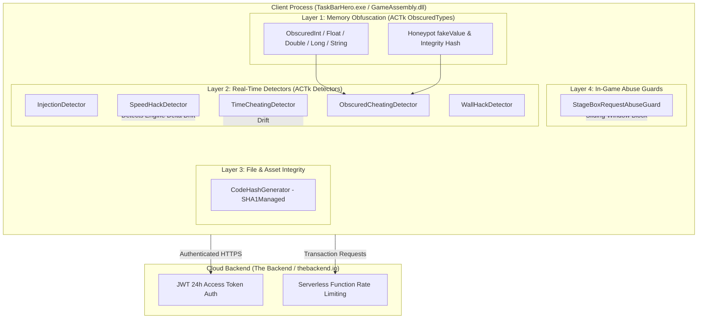
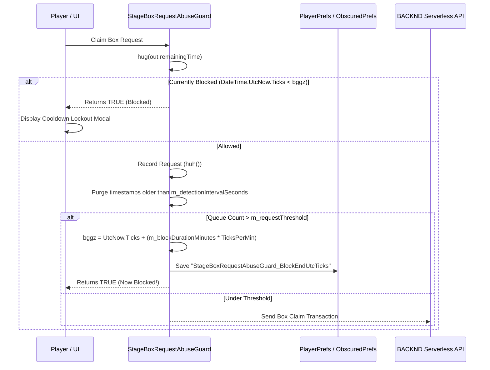

# Deep Technical Analysis: Anti-Cheat & Defense Architecture in TaskBarHero

**Document ID:** DOC-ANALYSIS-2026-ACTK  
**Target Application:** *TaskBarHero* (Steam AppID: `3678970`)  
**Engine:** Unity 6000.0.72f1, x86_64 IL2CPP  
**Anti-Cheat Framework:** CodeStage Anti-Cheat Toolkit (ACTk) v6.8.0 + Custom In-Game Guards + The Backend (BACKND) BaaS Security  
**Status:** Documented & Reverse-Engineered  

---

## 1. Executive Overview

*TaskBarHero* implements a **multi-tiered defense-in-depth model** combining third-party commercial anti-cheat middleware, custom in-game rate-limiting heuristics, and cloud backend authorization checks.



The game relies on five distinct defensive layers:
1. **Memory Obfuscation Layer:** CodeStage ACTk `ObscuredTypes` protecting sensitive attributes (player stats, currencies, level values, hero attributes). Naive memory editing triggers honeypots.
2. **Real-Time Behavioral Detectors:** ACTk `ACTkDetectorBase<T>` components running polling loops and frame hooks to monitor injection, hardware clock drift, network time divergence, and rendering hooks.
3. **Static File Integrity:** ACTk `CodeHashGenerator` using parallel SHA-1 file hashing across game binaries and streaming assets to detect disk patching.
4. **Application-Level Abuse Guard:** Custom sliding-window rate limiters (`StageBoxRequestAbuseGuard`) that detect burst requests and enforce multi-minute client-side penalties.
5. **Cloud Backend Security:** The Backend (`thebackend.io`) BaaS enforcing 24-hour JSON Web Token (JWT) lifetimes, signed session integrity, and serverless API concurrency throttles.

---

## 2. Layer 1: Memory Obfuscation & Obscured Types

### 2.1 Struct Layout & Cryptographic Mechanisms

The game wraps sensitive in-memory variables using CodeStage ACTk v6.8.0 value types defined in namespace `CodeStage.AntiCheat.ObscuredTypes`.

#### `ObscuredInt` (16 bytes, struct, TypeDefIndex: 19839)
```cpp
struct ObscuredInt
{
  int32_t hash;             // offset +0x00: Integrity hash matching .NET Int32.GetHashCode()
  int32_t hiddenValue;      // offset +0x04: Encrypted ciphertext (plainValue ^ currentCryptoKey)
  int32_t currentCryptoKey; // offset +0x08: Random 32-bit symmetric XOR key
  int32_t fakeValue;        // offset +0x0C: Honeypot variable exposed to memory scanners
};
```

#### `ObscuredFloat` (20 bytes, struct, TypeDefIndex: 19837)
```cpp
struct ObscuredFloat
{
  int32_t hash;             // offset +0x00: Bit-level hash of IEEE-754 float representation
  int32_t hiddenValue;      // offset +0x04: Encrypted bits (floatBits ^ currentCryptoKey)
  int32_t currentCryptoKey; // offset +0x08: Random 32-bit symmetric XOR key
  float   fakeValue;        // offset +0x0C: Honeypot float exposed to memory scanners
  uint8_t hiddenValueOld[4];// offset +0x10: Legacy migration buffer (ACTkByte4)
};
```

#### `ObscuredDouble` (40 bytes, struct, TypeDefIndex: 19835)
```cpp
struct ObscuredDouble
{
  int32_t hash;             // offset +0x00: Hash of 64-bit float representation
  int32_t padding;          // offset +0x04: Compiler 8-byte alignment padding
  int64_t hiddenValue;      // offset +0x08: Encrypted 64-bit ciphertext
  int64_t currentCryptoKey; // offset +0x10: Random 64-bit symmetric XOR key
  double  fakeValue;        // offset +0x18: Honeypot double
  uint8_t hiddenValueOld[8];// offset +0x20: Legacy migration buffer (ACTkByte8)
};
```

#### `ObscuredLong` (32 bytes, struct, TypeDefIndex: 19840)
```cpp
struct ObscuredLong
{
  int32_t hash;             // offset +0x00: (int)(value ^ (value >> 32))
  int32_t padding;          // offset +0x04: 8-byte alignment padding
  int64_t hiddenValue;      // offset +0x08: Encrypted 64-bit ciphertext
  int64_t currentCryptoKey; // offset +0x10: Random 64-bit symmetric XOR key
  int64_t fakeValue;        // offset +0x18: Honeypot int64
};
```

#### `ObscuredString` (Heap Object, TypeDefIndex: 19845)
```cpp
class ObscuredString
{
  int32_t hash;             // offset +0x10
  char*   cryptoKey;        // offset +0x18: Managed array of char
  char*   hiddenChars;      // offset +0x20: Managed array of encrypted char
  String* inMemoryString;   // offset +0x28: Cached plain string (when decrypted)
  String* currentCryptoKey; // offset +0x30: Managed string crypto key
  uint8_t* hiddenValue;     // offset +0x38: Managed byte array
};
```

### 2.2 Integrity Hash Algorithms

ACTk calculates the hash directly based on the .NET `GetHashCode()` algorithms:

| Type | Hash Computation Algorithm |
| :--- | :--- |
| **`ObscuredInt`** | `hash = value;` |
| **`ObscuredLong`** | `hash = (int32_t)(value ^ (value >> 32));` |
| **`ObscuredFloat`** | `int32_t bits = *(int32_t*)&value; hash = (value == 0.0f) ? 0 : bits;` |
| **`ObscuredDouble`** | `int64_t bits = *(int64_t*)&value; hash = (value == 0.0) ? 0 : (int32_t)(bits ^ (bits >> 32));` |

### 2.3 The Honeypot Architecture (`fakeValue`)

1. **Trap Mechanism:** When an attacker uses standard memory scanning tools (Cheat Engine, ArtMoney, ScanMem) to search for gold, hero damage, or rune levels, they match `fakeValue`.
2. **Detection Trigger:** If `fakeValue` is overwritten in memory without updating `hiddenValue` and `hash`, the next time the game executes `op_Implicit` or variable access, ACTk checks:
   $$\text{decryptedValue} = \text{hiddenValue} \oplus \text{currentCryptoKey}$$
   $$\text{computedHash} = \text{GetHashCode}(\text{decryptedValue})$$
   $$\text{tampered} = (\text{computedHash} \neq \text{hash}) \lor (\text{fakeValue} \neq \text{decryptedValue})$$
3. When `tampered == true`, ACTk notifies `ObscuredCheatingDetector`, which dispatches the detection event.

### 2.4 Why Direct Byte Patching of `op_Implicit` Fails

Early attempts to neutralize ACTk by patching `ObscuredInt.op_Implicit` (RVA: `0x730B10`) or `ObscuredDouble.op_Implicit` (RVA: `0x72E070`) with simple `ret` or scalar x86_64 stubs caused immediate segmentation faults or blank user interfaces:
* In the Microsoft x64 calling convention, structs larger than 8 bytes (such as `ObscuredInt` at 16 bytes, `ObscuredDouble` at 40 bytes) are **passed by reference via pointer in RCX**, and complex return values use hidden pointer parameters.
* Overwriting the function preamble breaks caller register preservation and stack alignment across hundreds of merged stub call sites in `GameAssembly.dll`.
* **Safe Solution:** Rather than patching `op_Implicit`, our tool writes all four struct fields (`hash`, `hiddenValue`, `currentCryptoKey`, `fakeValue`) **atomically** in memory using `ProcessMemory::WriteBytes()`, maintaining 100% cryptographic and hash validity.

---

## 3. Layer 2: Real-Time Detectors (`CodeStage.AntiCheat.Detectors`)

All runtime detectors inherit from the generic base class `ACTkDetectorBase<T>` (`TypeDefIndex: 19884`).

```text
ACTkDetectorBase<T>
 ├── InjectionDetector        (TypeDefIndex: 19888)
 ├── ObscuredCheatingDetector (TypeDefIndex: 19890)
 ├── SpeedHackDetector        (TypeDefIndex: 19892)
 ├── TimeCheatingDetector     (TypeDefIndex: 19908)
 └── WallHackDetector         (TypeDefIndex: 19912)
```

### 3.1 Common Base Architecture: `ACTkDetectorBase<T>`

* **Fields:**
  * `autoStart` (bool): If enabled in the scene GameObject, detector starts automatically upon `Start()`.
  * `autoDispose` (bool): Disposes detector upon detection.
  * `detectionEvent` (`UnityEvent`): Event invoked on the main Unity thread upon cheat confirmation.
* **Virtual Method Table Structure:**
  * Slot 5: `Start()`
  * Slot 6: `OnDestroy()`
  * Slot 11: `bbkt(djz a)` — Cheat verification & event dispatch
  * Slot 18: `bbla()` — **`DetectorCore()`**: The internal detector routine that initiates background threads, coroutines, and polling loops.

---

### 3.2 Individual Detector Deep Dive

#### 1. `InjectionDetector` (RVA: `0x763230`)
* **Purpose:** Detects unauthorized DLL injection, thread creation, and managed assembly tampering.
* **Mechanics:**
  * Enumerates loaded AppDomain assemblies and modules.
  * Checks module file paths and signatures against known injection libraries (e.g. Cheat Engine DBVM, generic proxy DLLs `version.dll`, `winmm.dll`).
* **Interception Point:** Method `bbla()` (DetectorCore) at `GameAssembly.dll + 0x763230`.

#### 2. `SpeedHackDetector` (Core RVA: `0x7651D0`, Update RVA: `0x764D50`)
* **Purpose:** Detects engine time scaling and high-resolution timer tampering.
* **Fields:**
  * `interval` (offset `0x60`, float): Polling interval in seconds (default: 1.0s).
  * `threshold` (offset `0x64`, float): Acceptable timer drift tolerance (range: 0.05 to 5.0).
  * `maxFalsePositives` (offset `0x68`, byte): Consecutive violation accumulator before raising alert.
  * `coolDown` (offset `0x6C`, int): Cooldown frames between detections.
  * `UseDsp` (offset `0x74`, bool): Compares elapsed engine time against `AudioSettings.dspTime` (DSP clock driven by physical audio buffer frequency).
  * `WatchTimeScale` (offset `0x75`, bool): Monitors `Time.timeScale` to detect programmatic timescale cheats.
* **Detection Mechanics:**
  * The detector samples two independent clocks:
    $$\Delta t_{\text{engine}} = \text{Time.realtimeSinceStartup}$$
    $$\Delta t_{\text{hardware}} = \text{Stopwatch.GetTimestamp()} \text{ or } \text{DateTime.UtcNow.Ticks}$$
  * If $|\Delta t_{\text{engine}} - \Delta t_{\text{hardware}}| > \text{threshold}$, an internal counter increments. If the count exceeds `maxFalsePositives`, `detectionEvent` fires.
* **Interception Points:**
  * `SpeedHackDetector.DetectorCore` (RVA: `0x7651D0`)
  * `SpeedHackDetector.Update` (RVA: `0x764D50`)

#### 3. `TimeCheatingDetector` (Core RVA: `0x767160`, Update RVA: `0x766B00`)
* **Purpose:** Prevents offline/idle cheating where players advance their local operating system clock (calendar time) to finish waiting timers or claim recurring daily rewards.
* **Fields:**
  * `requestUrl` (offset `0x68`, string): Online time endpoint (e.g., Google NTP, WorldTimeAPI, or backend timestamp server).
  * `timeoutSeconds` (offset `0x74`, int): Network request timeout.
  * `interval` (offset `0x78`, float): Periodic check interval in seconds.
  * `realCheatThreshold` (offset `0x7C`, int): Maximum permitted discrepancy against server time (10–180s).
  * `wrongTimeThreshold` (offset `0x80`, int): Allowed drift tolerance (1–180s).
* **Mechanics:**
  * Runs async tasks `<GetOnlineTimeTask>d__63` and `<GetOnlineTimeAwaitable>d__67` using `UnityWebRequest`.
  * Parses HTTP response `Date` headers or NTP timestamps to obtain actual real-world UTC time.
  * Compares network time against `DateTime.UtcNow`. If $|t_{\text{network}} - t_{\text{local}}| > \text{realCheatThreshold}$, detection triggers.
* **Interception Points:**
  * `TimeCheatingDetector.DetectorCore` (RVA: `0x767160`)
  * `TimeCheatingDetector.Update` (RVA: `0x766B00`)

#### 4. `ObscuredCheatingDetector` (Core RVA: `0x763620`)
* **Purpose:** Central receptor and dispatcher for all `ObscuredTypes` violations across the entire managed heap.
* **Fields:**
  * `honeyPot` (offset `0x60`, bool): Enables active periodic scanning of honeypot addresses.
  * `doubleEpsilon`, `floatEpsilon`, `vector3Epsilon` (offsets `0x68`-`0x78`): Floating point rounding tolerances.
* **Mechanics:**
  * Receives callbacks from `ObscuredInt`, `ObscuredLong`, etc., via methods `bblw` and `bblx`.
  * Gathers context telemetry (type affected, tampered values, stack frame) into container `dkb` and dispatches `detectionEvent`.
* **Interception Point:** `ObscuredCheatingDetector.DetectorCore` (RVA: `0x763620`).

#### 5. `WallHackDetector` (Core RVA: `0x76C7C0`, Update RVA: `0x76C310`, FixedUpdate RVA: `0x76B860`)
* **Purpose:** Monitors physical collider penetration and custom shader/wireframe tampering.
* **Four Independent Verification Modules:**
  1. **Rigidbody Module (`StartRigidModule`):** Spawns a physical `Rigidbody` inside a sealed collider box. If external physics velocity modifications or noclip let it escape, collision violation is logged.
  2. **Controller Module (`StartControllerModule`):** Spawns a `CharacterController` testing ground detection and wall slide behavior.
  3. **Wireframe / Shader Module (`ShootWireframeModule`):** Renders a hidden object using shader `Hidden/ACTk/WallHackTexture` onto an offscreen `RenderTexture`. It samples output pixel colors (`bbrk(Color a, Color b)`); if color discrepancies appear, wallhack chams or wireframe rendering modifications are active.
  4. **Raycast Module (`ShootRaycastModule`):** Fires `Physics.RaycastNonAlloc` rays across controlled geometries; if ray penetrations do not intersect expected colliders, physics tampering is confirmed.
* **Interception Points:**
  * `WallHackDetector.DetectorCore` (RVA: `0x76C7C0`)
  * `WallHackDetector.Update` (RVA: `0x76C310`)
  * `WallHackDetector.FixedUpdate` (RVA: `0x76B860`)

---

## 4. Layer 3: File & Binary Integrity (`Genuine.CodeHash`)

Namespace: `CodeStage.AntiCheat.Genuine.CodeHash` (TypeDefIndex: 19866–19880)

* **Components:**
  * `CodeHashGenerator`: Computes cryptographic digests of game files in background worker threads.
  * `djs`: Cryptographic wrapper encapsulating `System.Security.Cryptography.SHA1Managed` (RVA: `0x75ED40`).
  * `djw.dju`: Parallel worker loop (`ParallelLoopState`, RVA: `0x782D60`) iterating through game asset bundles and native binaries.
  * `FilteringSettings` (`djo`): File inclusion and exclusion masks divided into `FilterGroup.Code` (`GameAssembly.dll`, `UnityPlayer.dll`) and `FilterGroup.Content` (`global-metadata.dat`, asset packs).
* **Vulnerability & Operating Characteristics:**
  * Code hash verification runs asynchronously during initialization or scene transitions.
  * Because our modifications operate **in-memory via Win32 VirtualProtectEx / RPM / WPM**, files on disk remain completely unmodified. Disk-based SHA-1 checksum verification yields valid results.

---

## 5. Layer 4: In-Game Custom Abuse Guards (`StageBoxRequestAbuseGuard`)

Namespace: `TaskbarHero` (TypeDefIndex: 712)

### 5.1 Architecture & Implementation

To protect the backend from automated scripting and rapid chest opening, the developers created an application-level sliding-window rate limiter:

```csharp
public class StageBoxRequestAbuseGuard : ob<StageBoxRequestAbuseGuard>
{
    [SerializeField] private float m_detectionIntervalSeconds; // 0x20 (e.g. 10.0s)
    [SerializeField] private int   m_requestThreshold;          // 0x24 (e.g. 10 requests)
    [SerializeField] private int   m_blockDurationMinutes;      // 0x28 (e.g. 5 minutes)
    private readonly Queue<long>   bggy;                        // 0x30: Request timestamp queue
    private long                   bggz;                        // 0x38: Block end UTC ticks
    private const string           bgha = "StageBoxRequestAbuseGuard_BlockEndUtcTicks";
}
```

### 5.2 Algorithmic Workflow



### 5.3 Root Cause of Box Claiming Lockouts

When running `speedhack.dll` at 10x–20x multiplier:
1. Box opening animations and timers finish in milliseconds.
2. The user or automation claims 10–20 boxes within 1–2 real seconds.
3. `StageBoxRequestAbuseGuard` counts >10 requests inside `m_detectionIntervalSeconds`, setting a 5-minute lockout flag in persistent storage (`StageBoxRequestAbuseGuard_BlockEndUtcTicks`).
4. **Neutralization:** Method `hug(out float remaining)` at RVA `0x8BE380` is patched with `31 C0 C3` (`xor eax, eax; ret`). This forces the function to return `false` (never blocked) and zeroes out the remaining penalty time.

---

## 6. Layer 5: Backend Cloud Security (The Backend / BACKND BaaS)

Target Backend: The Backend (`thebackend.io` BaaS)

### 6.1 Authentication Token Architecture
* **Access Token (`accessToken`):** Signed RS256/HS256 JWT with a strict 24-hour expiration window (`exp`).
* **Refresh Token (`refreshToken`):** Long-lived persistence token stored locally.
* **Server Verification:** Every state-syncing endpoint (inventory update, stage completion, gacha draw) transmits the access token in HTTP headers. The server checks:
  $$\text{CurrentUtcTime}_{\text{server}} < \text{Token}_{\text{exp}}$$

### 6.2 Mechanism of Induced Failures

| Error Code | Failure Mode | Trigger Mechanism | Mitigation / Fix |
| :--- | :--- | :--- | :--- |
| **Error 401** | `BadUnauthorizedException` | Hooking `GetSystemTimeAsFileTime` advanced .NET `DateTime.UtcNow` by 24 virtual hours in 1 hour of real gameplay, prematurely expiring the JWT access token. | Confine speedhack hooks strictly to `UnityPlayer.dll`; exclude `GetSystemTimeAsFileTime`. |
| **Error 0** | `ConnectionError` | Warping `QueryPerformanceCounter` inside HTTP client shortened `UnityWebRequest` 5s timeout to <250ms, causing premature abort before cloud functions answered. | Drop speedhack to 1x–3x during batch transactions; exclude `GameAssembly.dll` networking. |

---

## 7. Master RVA & Neutralization Reference Table

All addresses mapped against `GameAssembly.dll` (Unity 6000.0.72f1, x86_64 IL2CPP):

| Class / Method | RVA | Original Purpose | Neutralization Patch | Patch Rationale |
| :--- | :--- | :--- | :--- | :--- |
| `InjectionDetector.DetectorCore` | `0x763230` | Starts DLL and injection monitoring | `31 C0 C3` (`xor eax, eax; ret`) | Suppresses initialization of scanning threads. |
| `SpeedHackDetector.DetectorCore` | `0x7651D0` | Starts hardware vs engine clock monitoring | `31 C0 C3` (`xor eax, eax; ret`) | Prevents detector coroutine from launching. |
| `SpeedHackDetector.Update` | `0x764D50` | Per-frame delta clock comparison | `31 C0 C3` (`xor eax, eax; ret`) | Neutralizes frame-by-frame polling watchdog. |
| `TimeCheatingDetector.DetectorCore` | `0x767160` | Starts online NTP / HTTP time checks | `31 C0 C3` (`xor eax, eax; ret`) | Prevents network time comparison tasks. |
| `TimeCheatingDetector.Update` | `0x766B00` | Per-frame time divergence checks | `31 C0 C3` (`xor eax, eax; ret`) | Neutralizes time cheating frame polling. |
| `ObscuredCheatingDetector.DetectorCore` | `0x763620` | Coordinates ObscuredType honeypot alerts | `31 C0 C3` (`xor eax, eax; ret`) | Silences event propagation from memory traps. |
| `WallHackDetector.DetectorCore` | `0x76C7C0` | Starts physics, raycast, and shader tests | `31 C0 C3` (`xor eax, eax; ret`) | Prevents instantiation of test colliders/shaders. |
| `WallHackDetector.Update` | `0x76C310` | Frame-by-frame visual/raycast checks | `31 C0 C3` (`xor eax, eax; ret`) | Neutralizes update cycle. |
| `WallHackDetector.FixedUpdate` | `0x76B860` | Physics step collision tests | `31 C0 C3` (`xor eax, eax; ret`) | Neutralizes fixed update cycle. |
| `StageBoxRequestAbuseGuard.hug` | `0x8BE380` | Evaluates if user is locked out of box claims | `31 C0 C3` (`xor eax, eax; ret`) | Forces function to return `false` (never blocked). |

---

## 8. Architectural Conclusions & Implementation Invariants

1. **Memory Manipulation Invariant:** Never modify ACTk types in memory by altering only one field. Always write the 4-tuple `(hash, hiddenValue, currentCryptoKey, fakeValue)` simultaneously using `ProcessMemory::WriteBytes` to avoid race conditions with `ObscuredCheatingDetector`.
2. **Speedhack Scoping Invariant:** Speedhack hooks (`QueryPerformanceCounter`, `timeGetTime`, `GetTickCount`) must **ONLY** intercept callers from `UnityPlayer.dll`. Intercepting `GameAssembly.dll` corrupts .NET networking (`HttpClient`), BACKND JWT lifetimes, and server timeouts.
3. **No Calendar Clock Interception:** Never hook `GetSystemTimeAsFileTime` or `GetSystemTimePreciseAsFileTime`. These functions govern wall-clock UTC time; warping them causes immediate HTTP 401 token authentication failures.
4. **Non-Destructive RVA Patching:** When patching detector entrypoints, use `31 C0 C3` (`xor eax, eax; ret`). This cleanly fulfills ABI return conventions for both `void` and `bool` methods without corrupting stack pointer registers.
